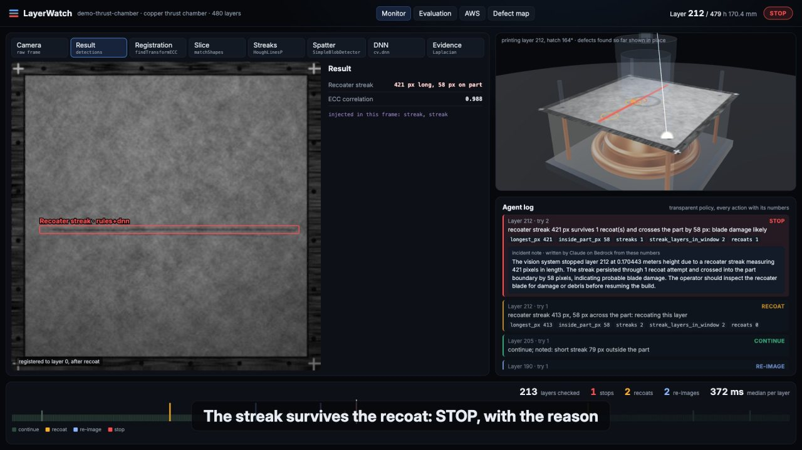

# LayerWatch

Layer by layer vision QA for metal 3D printing. A laser powder bed fusion machine prints a part one thin layer at a
time, and one bad layer (a recoater streak, spatter, an edge curling up, a short powder feed) can ruin a build that
runs for days. LayerWatch looks at the two camera frames every layer produces, registers them to the first layer,
compares what was melted with what the part file says should be melted, finds defects with classic OpenCV 5 plus a
small U-Net run through `cv.dnn`, and a transparent agent turns the measurements into an action: continue, recoat
again, re-image, or stop the build. Every action carries its reason and the numbers that triggered it. A 3D map shows
where every finding sits inside the finished part.

OpenCV version used everywhere in this repo: **5.0.0** (`opencv-contrib-python 5.0.0.93`, asserted in `tests/test_opencv5.py`).



## Results at a glance

Synthetic hold-out: 400 layers from 10 simulated builds generated after every threshold was frozen
(full tables, plots and failure analysis in [docs/LayerWatch_Report.pdf](docs/LayerWatch_Report.pdf)).

| Defect | Rules only F1 | DNN only F1 | Rules + DNN F1 |
|---|---:|---:|---:|
| Recoater streak | 0.97 | 0.99 | 0.97 |
| Spatter | 0.85 | 0.87 | 0.92 |
| Super elevation | 0.84 | 0.97 | 0.93 |
| Short feed | 0.99 | 1.00 | 1.00 |
| **Macro F1** | **0.91** | **0.96** | **0.95** |

| Agent and pipeline | Hold-out |
|---|---:|
| Unusable frames (strong glare or blur) caught by the evidence gate | 50 of 51 |
| Mild glare or blur frames wrongly rejected | 0 of 42 |
| Layers needing recoat or stop that the agent let through | 13 of 170 (all 13 were detected; policy threshold gap, see report) |
| False stops | 5 (27.9 per 1,000 good layers) |
| ECC registration error (true vibration known) | median 0.13 px, max 0.38 px |
| Latency per layer, two frames, this laptop (arm64, shared with other jobs) | median 472 ms, p95 794 ms |

Real images, zero shot: 250 labelled powder bed frames of an EOS M290 (Aalto University, CC-BY 4.0). Recoat checks
only, thresholds unchanged, no DNN: 45% of the 803 labelled defect boxes found, 92% of detections land on a labelled
box, streak detector precision 96% (200 of 208).

## Run it

Requirements: macOS or Linux, Python 3.12 via [uv](https://docs.astral.sh/uv/), Node 20+.

```bash
make setup          # .venv with opencv-contrib-python 5, torch CPU, fastapi ...; npm install for dashboard + CDK
make data           # synthetic dataset: 2,000 train, 400 test, 400 hold-out layers (about 3 minutes on 4 cores)
make train          # U-Net on CPU, 4 threads, early stop or 40 minutes, export ONNX, check cv.dnn == torch
make eval           # hold-out + dev test metrics, then real images (needs data/real, see below)
make demo           # 480 layer demo build through the handler, writes dashboard/public/run
make report         # docs/LayerWatch_Report.md, .html, figures, .pdf
make test           # 23 unit tests (policy, part function, pipeline, handler, OpenCV 5)
make serve          # Lambda handler behind FastAPI + built dashboard: http://localhost:8304
make dashboard      # or the Vite dev server: http://localhost:5304 (proxies /api to 8304)
make synth          # CloudFormation for the AWS stack (no credentials needed)
make film           # with the dev server running: output/layerwatch-screen.mp4
```

The trained model (`models/layerwatch_unet.onnx`, 1.9 MB), the evaluation JSON and the report are committed, so
`make demo && make serve` works without regenerating data or retraining.

Real data (optional, for `make eval-real`): download "Original Images and Manual Labels.zip" from
[doi:10.5281/zenodo.14996805](https://doi.org/10.5281/zenodo.14996805) and copy every 6th labelled powder bed image
(`PB/*.jpg` with a matching `PB_label/*.xml`) into `data/real/images` and `data/real/labels`.

### Dashboard keys

Left and right arrows step layers (Shift for 10), up and down step attempts, N and P jump to the next or previous
event, 1 to 8 pick the pipeline stage, F switches the recoat and melt frame, Space plays, Q W E R switch the views
(Monitor, Evaluation, AWS, Defect map), A sends the current layer's two frames to the local endpoint and shows the
answer.

### Local endpoint

```bash
curl localhost:8304/api/health
# {"ok":true,"opencv":"5.0.0","arch":"arm64",...}
POST /api/builds/{id}          {"camera": {...}, "reference_b64": "<layer 0 jpg>"}
POST /api/builds/{id}/layers   {"layer_index": 212, "recoat_b64": "...", "melt_b64": "..."}
GET  /api/builds/{id}/log
```

## How it works

```
 printer camera          OpenCV 5 pipeline (layerwatch/vision)                     agent (layerwatch/agent)
 recoat + melt  ──►  (a) undistort + keystone (calibration), ECC homography  ──►  evidence first:
 frames per layer        to layer 0 on the static rim, warpPerspective              bad frame -> RE_IMAGE
                     (f) evidence: Laplacian variance (half scale), gradient     then severity:
                         anisotropy, saturated pixels, ECC correlation              streak across part -> RECOAT,
                     (b) slice from the part function vs melted region:            survives recoat -> STOP
                         Otsu + adaptiveThreshold, morphology, contours,           short feed -> RECOAT (max 2)
                         IoU, matchShapes                                           big or repeated super elevation -> STOP
                     (c) streaks: dark detail, opening with a 41 px line           slice IoU too low -> STOP
                         kernel, HoughLinesP, merge, length + angle                 spatter -> note for CT
                         short feed: texture adaptive dark patches                 then trends over 10 layers
                     (d) spatter: top hat + SimpleBlobDetector + MOG2 over        every action: reason + numbers
                         past layers, cluster rule; super elevation crescents     optional: Claude on Bedrock words
                     (e) U-Net (3 in: recoat, melt, expected slice; 5 classes)     the STOP note from those numbers
                         via cv.dnn.readNetFromONNX, fused with the rules
                                   │
 server/handler.py  ── same code as the AWS Lambda function and behind FastAPI ──► layer log (DynamoDB / local jsonl)
                                                                                 ► CloudWatch metrics (EMF)
```

* `layerwatch/part.py`: the part, a regeneratively cooled thrust chamber with 36 cooling channels and four test bars,
  as one function `solid(x, z, h)`. The expected slice, the synthetic images and the 3D map all come from it.
* `layerwatch/synth/`: synthetic powder bed camera. Multi scale powder texture, angled lamp gradient and vignette,
  keystone homography, radial lens distortion, per layer vibration, previous layer bleed, hatch texture rotated 67
  degrees per layer, contour scan, sensor noise and JPEG. Injected defects with pixel masks; glare and motion blur as
  nuisances. Domain randomisation per build.
* `layerwatch/train/`: U-Net (482,805 parameters), PyTorch CPU, 256 px crops, class weighted cross entropy.
* `layerwatch/eval/`: metrics, real image evaluation, report.
* `server/`: Lambda handler, storage adapters (local folder or S3 + DynamoDB), FastAPI runner, SQS worker for the COOL path.
* `infra/`: AWS CDK (Python).
* `dashboard/`: Vite + TypeScript + Three.js.

## AWS

`infra/` is an AWS CDK app (Python): S3 bucket for layer frames (SSE, TLS only, public access blocked, 180 day
expiry), the worker as an AWS Lambda container image on **arm64 (Graviton)** triggered by S3 uploads, DynamoDB layer
log, CloudWatch metrics through the Embedded Metric Format, a dashboard, an alarm on stop events with SNS, an IAM
authenticated Function URL. Least privilege: the worker can get and put objects under `builds/*` in its bucket and put
and query items in its table, nothing else. `-c compute=cool -c coolAmiId=ami-...` swaps Lambda for an EC2 Graviton
(c7g) instance from the Cloud-Optimized OpenCV Library (COOL) Marketplace AMI, fed by SQS, running the same handler.

**Status: not deployed.** No AWS account was used for this project. What is verified: `cdk synth` passes for both
variants (18 resources for Lambda, 29 for the COOL path), the arm64 runtime dependencies (OpenCV 5.0.0.93 headless,
numpy, boto3) resolve for Linux aarch64, and the exact handler the Lambda runs is exercised locally by the tests, the
demo build and `make serve`. Not verified: the Docker image build (no Docker on the build machine), the deploy itself,
latency on Graviton, the COOL AMI. `make deploy` is the one command once an account, credentials and Docker exist.

## What is new and what existed before

Built during the competition: everything in this repository. The one reused piece is the part function: the
`solid(x, z, h)` thrust chamber geometry was written by me earlier for a browser simulation of a metal printer and is
ported here to numpy (and copied to TypeScript for the dashboard). Real images come from a public dataset (below).

## Tests

`make test` runs 23 tests: OpenCV major version is 5 and every API the pipeline uses exists; the part function
(known points, exactly 36 cooling channels, symmetry); the agent policy (bad evidence always re-images and stops after
two tries, streak recoat then stop, trends, short feed, super elevation, slice mismatch, spatter never stops, every
decision carries numbers); the pipeline on rendered frames (registration recovers the vibration, a streak is found and
crosses the part, glare fails the evidence check, every stage writes an overlay); the handler round trip, cold start
rebuild from the log, and the Lambda event path.

## Limitations

* The headline numbers are on synthetic images whose defects I designed. They show the pipeline does what it was
  built to do; they are not a measure of accuracy on a real machine. The real image check covers recoat defects only,
  has one class and box labels, and gets 45% box recall zero shot.
* Agent misses on the hold-out are a policy calibration gap (label and policy thresholds for super elevation disagree),
  reported unchanged.
* The demo build images 480 heights through a 385 mm part, so one demo layer stands for many real 40 micron layers.
  Its events (streak at layer 212, glare at 150, and so on) are scripted injections.
* The synthetic camera has 0.86 mm per pixel; production machines resolve finer.
* Latency was measured on a laptop shared with other heavy jobs. Graviton latency was not measured.
* The U-Net trained for 38 minutes on CPU and was still improving when the time budget ran out.
* The incident note is written by Claude on Amazon Bedrock from the logged numbers during `make demo` (a real call)
  and replayed in the dashboard and film. Without a key a template note is used. The model never measures anything.
* Not a certification or qualification tool. A stop asks a person to look.

## Data and libraries

* Real images: "Annotated Image Dataset for defects detection in Laser Powder Bed Fusion", Aalto
  University, Zenodo record 14996806, [doi:10.5281/zenodo.14996805](https://doi.org/10.5281/zenodo.14996805), CC-BY 4.0. Not
  redistributed here; 250 frames sampled for evaluation only.
* OpenCV 5 (Apache 2.0), NumPy, SciPy, PyTorch (BSD), ONNX, FastAPI, Uvicorn, Pydantic, boto3, AWS CDK (Apache 2.0),
  matplotlib, Three.js (MIT), Vite (MIT), Playwright (Apache 2.0) for the film and the PDF.

## License

Apache 2.0, see [LICENSE](LICENSE).
