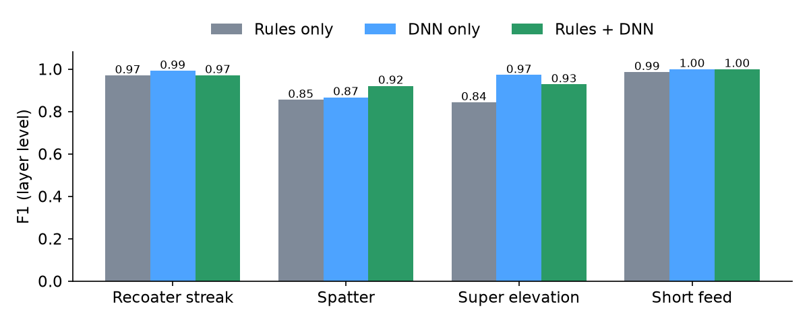
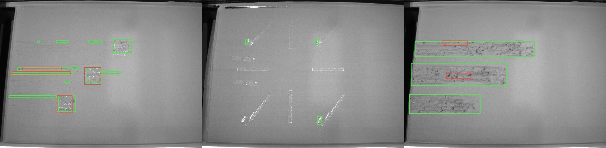
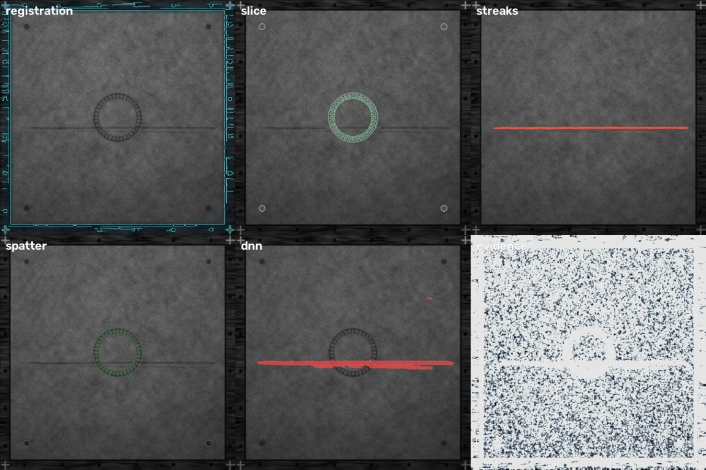
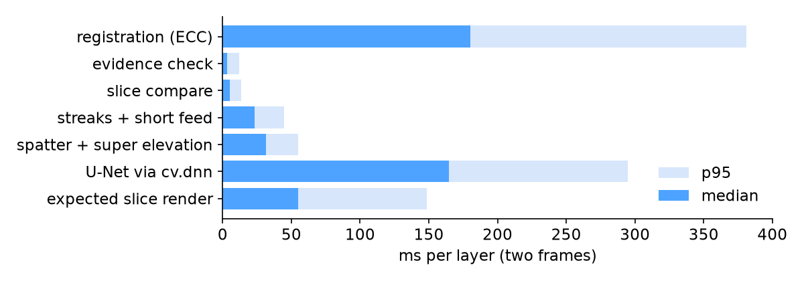
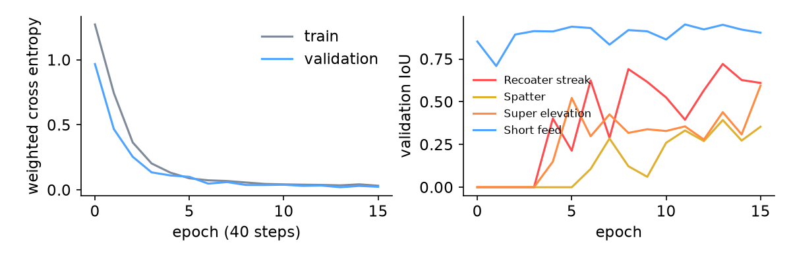

# LayerWatch: evaluation report

Layer by layer vision QA for laser powder bed fusion, built on OpenCV 5.0.0.
Generated by `make report` from `docs/eval/*.json`; every number below is read from those files.

## 1. What is measured

* **Synthetic hold-out**: 400 layers from 10 simulated builds (new camera, lamp,
  powder and defect seeds) generated after all thresholds were frozen. None of these images was used for training,
  validation or tuning. A second synthetic split ("dev test", 400 layers) was looked at while
  tuning thresholds; its numbers are in `docs/eval/synthetic_test.json` and are not the headline.
* **Real images**: 250 labelled powder bed frames of an EOS M290 (Aalto University dataset, CC-BY 4.0,
  doi:10.5281/zenodo.14996805), zero shot: recoat checks only, thresholds unchanged, no DNN.
* **Closed loop demo build**: 480 layers through the real handler with scripted events (section 6).

Scoring is per layer: a defect type counts as found on a layer if the detector reports at least one region of that
type. Frames with strong glare or motion blur are scored only on whether the evidence gate rejects them.

## 2. Detection on the synthetic hold-out

| Defect | Rules only P | R | F1 | DNN only P | R | F1 | Rules + DNN P | R | F1 |
|---|---:|---:|---:|---:|---:|---:|---:|---:|---:|
| Recoater streak | 0.96 | 0.98 | 0.97 | 0.98 | 1.00 | 0.99 | 0.94 | 1.00 | 0.97 |
| Spatter | 1.00 | 0.75 | 0.85 | 0.98 | 0.78 | 0.87 | 0.98 | 0.87 | 0.92 |
| Super elevation | 0.87 | 0.82 | 0.84 | 0.97 | 0.97 | 0.97 | 0.88 | 0.99 | 0.93 |
| Short feed | 1.00 | 0.97 | 0.99 | 1.00 | 1.00 | 1.00 | 1.00 | 1.00 | 1.00 |
| **macro F1** |  | | **0.91** |  | | **0.96** |  | | **0.95** |

Counts:

| Defect | Rules only TP / FP / FN | DNN only TP / FP / FN | Rules + DNN TP / FP / FN |
|---|---:|---:|---:|
| Recoater streak | 65 / 3 / 1 | 66 / 1 / 0 | 66 / 4 / 0 |
| Spatter | 50 / 0 / 17 | 52 / 1 / 15 | 58 / 1 / 9 |
| Super elevation | 59 / 9 / 13 | 70 / 2 / 2 | 71 / 10 / 1 |
| Short feed | 68 / 0 / 2 | 70 / 0 / 0 | 70 / 0 / 0 |

DNN pixel IoU per class on usable hold-out frames: Recoater streak 0.77, Spatter 0.59, Super elevation 0.72, Short feed 0.94

## 3. The agent

| Measure | Value |
|---|---:|
| Layers | 400 |
| Unusable frames (strong glare or blur) | 51 |
| Decisions made on an unusable frame (should be 0) | 1 |
| Evidence gate precision / recall | 1.00 / 0.98 |
| Mild nuisance frames (should pass) flagged | 0 of 42 |
| Layers that need a recoat or stop (by injected geometry) | 170 |
| Missed critical layers (agent said continue) | 13 |
| False stops on layers that did not need one | 5 (27.9 per 1,000 good layers) |
| Any intervention on layers that did not need one | 5 (27.9 per 1,000) |
| Actions | CONTINUE 187, RECOAT 86, RE_IMAGE 50, STOP 77 |

"Needs intervention" is defined from the injected geometry only: a streak at least 150 px long or crossing the part,
a short feed patch of at least 500 px, or a super elevation crescent of at least 250 px. The hold-out layers of one
build are 40 random heights, not consecutive layers, so trend rules (streaks on 3 of the last 10 layers, super
elevation on 2 layers in a row) fire less often than they would on a real build.

### Where the agent went wrong

All 13 missed critical layers: the defect was detected in 13 of them (Recoater streak 1, Super elevation 12). The miss is in the policy, not the vision: the label calls a super elevation critical from 250 px of area, the policy stops on a crescent arc of 60 px or on two layers in a row, so crescents under 60 px of arc but over 250 px of area fall between the two; the streak was measured just under the 150 px length rule. 5 of the 5 false stops come from the opposite side of the same rule (a small crescent on two consecutive sampled layers). These policy thresholds were set before the hold-out was generated and are reported unchanged; aligning the label and policy definitions is the first next step.

## 4. Registration and slice comparison

* ECC homography against the layer 0 frame, using only the static chamber rim: median corner error
  0.13 px, p95 0.22 px, max 0.38 px
  (true vibration known from the generator).
* Melted region vs the slice from the part function, layers with at least 400 px of slice: median IoU
  0.87, 5th percentile 0.70.

## 5. Real powder bed images (zero shot)

| Measure | Value |
|---|---:|
| Labelled frames | 250 (67 from build 123521, 22 from build 095904, 161 from build 120348) |
| Labelled defect boxes | 803 |
| Boxes hit by a LayerWatch detection (recall) | 0.45 |
| Detections that hit a labelled box (precision) | 0.92 |
| Frames with at least one labelled box found | 0.60 |
| Detections per frame | 1.69 |
| streak detector precision | 0.96 (200 of 208) |
| bright_blobs detector precision | 0.89 (190 of 214) |

Green: annotator boxes. Red: LayerWatch detections mapped back to the camera image. The labels are one class
("defects") drawn as boxes, so this measures where LayerWatch looks, not whether it names the type right.
Calibration for these frames is a 4 point homography picked by hand once; there is no layer 0 frame, so
registration is not exercised, and the lighting reference is the per build median frame.

## 6. Closed loop demo build

480 layers of the thrust chamber on one simulated machine, run through the same handler the Lambda runs. Actions:
CONTINUE 480, RECOAT 4, RE_IMAGE 2, STOP 1, OPERATOR 1. Median handler latency 287 ms (p95 708 ms).

* Stop at layer 212: recoater streak 421 px survives 1 recoat(s) and crosses the part by 58 px: blade damage likely. Note (us.anthropic.claude-sonnet-4-5-20250929-v1:0): The vision system stopped layer 212 at 0.170443 meters height due to a recoater streak measuring 421 pixels in length. The streak persisted through 1 recoat attempt and crossed into the part boundary by 58 pixels, indicating probable blade damage. The operator should inspect the recoater blade for damage or debris before resuming the build.

Stage overlays of layer 212 after the recoat: registration, slice compare, streaks, spatter and super elevation, DNN, evidence.

## 7. Latency

Median 472 ms, p95 794 ms per layer (two frames) on macOS-15.8.1-arm64-arm-64bit, a laptop
that was shared with other heavy jobs during the run, so these are upper bounds. Graviton numbers need the AWS deploy
(`make deploy`), which is pending an AWS account.

## 8. The learned segmenter

U-Net, 482,805 parameters, trained on CPU (4 threads) for 16 epochs of 40 steps
(38 minutes wall clock on a shared machine), best validation loss at epoch 13.
Exported to ONNX and run with `cv.dnn.readNetFromONNX`; maximum absolute difference to PyTorch on a random input:
9.5e-06.

## 9. Limits

* The headline numbers are on synthetic images whose defects I designed. They show the pipeline does what it is built
  to do; they do not show real world accuracy. The real image check covers recoat defects only and has box labels.
* The synthetic camera is 512 x 512 at 0.86 mm per pixel; real machines use more pixels per mm.
* The demo build samples 480 heights through a 385 mm part, so one demo layer stands for many 40 micron layers.
* Not a certification tool. A stop is a request for a person to look.
